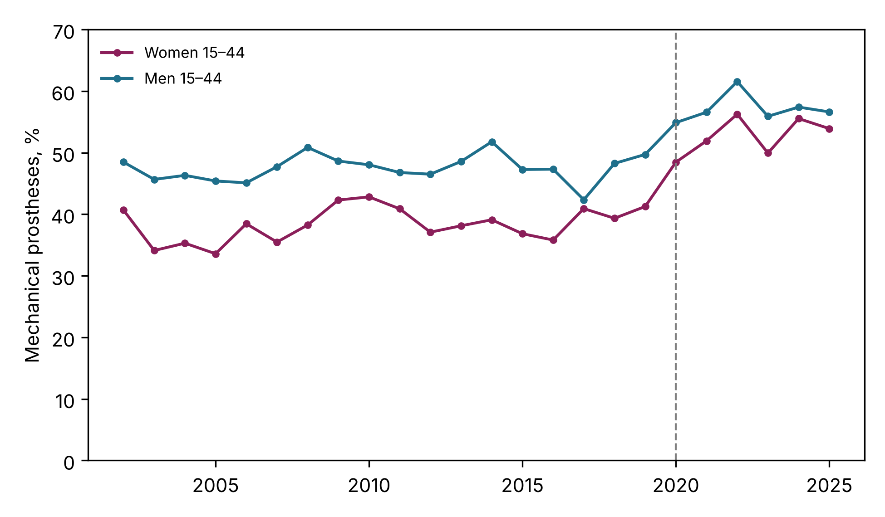

# Figure S1. Flowchart counts

| step                                                                              |      n |
|:----------------------------------------------------------------------------------|-------:|
| AIH with a valve-prosthesis OPM code, 2008–2025                                   | 225321 |
| Excluded: both biological and mechanical prostheses billed                        |   1021 |
| Excluded: valve position indeterminada                                            |  49563 |
| Excluded: valve position dupla/múltipla                                           |  21547 |
| Excluded: valve position tric/pulm                                                |   4194 |
| Excluded: valve position múltipla                                                 |   3421 |
| Excluded: age <18 years or missing                                                |   2216 |
| Analysis cohort (adults, isolated aortic or mitral position, one prosthesis type) | 143359 |

# Figure S2. Mechanical prostheses in patients aged 15–44 years by sex, 2002–2025

# Table S1. Mechanical prostheses (%) by sex, valve position, age group and period, 2002–2025

| sexo   | valva   | fx    |   2000–2007 |   2008–2012 |   2013–2017 |   2018–2019 |   2020–2021 |   2022–2025 |
|:-------|:--------|:------|------------:|------------:|------------:|------------:|------------:|------------:|
| F      | aórtica | 18–39 |        39   |        45.5 |        41.4 |        37   |        52.8 |        54.5 |
| F      | aórtica | 40–49 |        47.2 |        51.5 |        46.5 |        49.8 |        62   |        60.6 |
| F      | aórtica | 50–59 |        43.6 |        47.4 |        40.9 |        43.6 |        45.5 |        50   |
| F      | aórtica | 60–64 |        23.9 |        33.5 |        26.1 |        22.3 |        25.8 |        28.2 |
| F      | aórtica | 65–69 |        17.3 |        19.1 |        15.4 |        13.9 |        12.7 |        14.3 |
| F      | aórtica | ≥70   |         7.4 |         6.1 |         4.1 |         3.6 |         3.5 |         4.8 |
| F      | mitral  | 18–39 |        33.5 |        36.6 |        34.4 |        37.5 |        46.8 |        50.9 |
| F      | mitral  | 40–49 |        39.1 |        46.1 |        45.2 |        47.1 |        54.4 |        56   |
| F      | mitral  | 50–59 |        34.5 |        42.9 |        41.9 |        43.8 |        48.8 |        51   |
| F      | mitral  | 60–64 |        23.6 |        30.2 |        29.1 |        33.3 |        33.2 |        35.2 |
| F      | mitral  | 65–69 |        16.5 |        20.6 |        18.2 |        17.9 |        21.5 |        19   |
| F      | mitral  | ≥70   |         7.3 |         5.6 |         5.4 |         5.5 |         7.5 |         6   |
| M      | aórtica | 18–39 |        54.1 |        54.2 |        54.3 |        52.7 |        58.1 |        63   |
| M      | aórtica | 40–49 |        49.5 |        52.6 |        46.8 |        50.7 |        53.3 |        55.7 |
| M      | aórtica | 50–59 |        45.6 |        43.3 |        39.9 |        41.7 |        45.8 |        46   |
| M      | aórtica | 60–64 |        31.8 |        32.9 |        27.1 |        27.3 |        26.2 |        29.7 |
| M      | aórtica | 65–69 |        19.8 |        19.9 |        15.8 |        13.6 |        15.5 |        16   |
| M      | aórtica | ≥70   |         7.5 |         7.1 |         4   |         3.9 |         4.6 |         5.2 |
| M      | mitral  | 18–39 |        42.4 |        41.3 |        43.5 |        43.6 |        54.7 |        53.1 |
| M      | mitral  | 40–49 |        43.4 |        46.6 |        45.7 |        47   |        53   |        56.2 |
| M      | mitral  | 50–59 |        38.4 |        41.5 |        38.5 |        44.6 |        48.9 |        48.8 |
| M      | mitral  | 60–64 |        26.9 |        29.9 |        30.8 |        28.8 |        33.3 |        35.2 |
| M      | mitral  | 65–69 |        19.1 |        21.7 |        16.4 |        18.4 |        15.3 |        19.4 |
| M      | mitral  | ≥70   |         8.7 |         7.7 |         5.3 |         7.3 |         6.8 |         7.7 |

# Table S2. Annual series 2000–2025

|   Unnamed: 0 |   ano |   AIH |   pct_mec |   pct_valva_indet |   idade_media |   AIH_total_com_ambas |
|-------------:|------:|------:|----------:|------------------:|--------------:|----------------------:|
|            0 |  2000 |  9283 |      33.3 |              42.2 |          47   |                  9351 |
|            1 |  2001 |  9946 |      34.1 |              42.7 |          47.3 |                 10018 |
|            2 |  2002 |  9916 |      34.9 |              15.8 |          48.4 |                  9960 |
|            3 |  2003 | 10027 |      32.4 |               4.4 |          49.4 |                 10063 |
|            4 |  2004 | 10131 |      32.2 |              16.2 |          49.2 |                 10174 |
|            5 |  2005 | 10427 |      32.6 |              33   |          49.8 |                 10455 |
|            6 |  2006 | 10487 |      32.9 |              33.7 |          50.3 |                 10502 |
|            7 |  2007 |  9683 |      33.5 |              25.5 |          50.6 |                  9722 |
|            8 |  2008 | 10791 |      33.9 |              23.4 |          51.5 |                 10867 |
|            9 |  2009 | 10794 |      34.6 |              22.2 |          51.8 |                 10842 |
|           10 |  2010 | 11191 |      34.5 |              20.8 |          52.7 |                 11236 |
|           11 |  2011 | 12277 |      32   |              20.8 |          53.3 |                 12315 |
|           12 |  2012 | 12594 |      30.9 |              20.9 |          53.3 |                 12636 |
|           13 |  2013 | 12663 |      30.2 |              18.6 |          54.3 |                 12718 |
|           14 |  2014 | 12602 |      31.2 |              17.5 |          54.7 |                 12633 |
|           15 |  2015 | 12284 |      29.6 |              21.2 |          55.3 |                 12320 |
|           16 |  2016 | 12417 |      27.9 |              22.7 |          55.6 |                 12457 |
|           17 |  2017 | 12186 |      28.3 |              23   |          56.2 |                 12215 |
|           18 |  2018 | 12448 |      30   |              24.3 |          56.4 |                 12478 |
|           19 |  2019 | 13551 |      29.7 |              23.8 |          56.8 |                 13608 |
|           20 |  2020 |  9951 |      30.1 |              25.2 |          57   |                  9982 |
|           21 |  2021 | 10416 |      34.2 |              23.4 |          57   |                 10461 |
|           22 |  2022 | 12747 |      36.3 |              23.4 |          57.8 |                 12803 |
|           23 |  2023 | 14404 |      31.9 |              22.1 |          58.3 |                 14447 |
|           24 |  2024 | 15645 |      31.5 |              21.7 |          58.3 |                 15779 |
|           25 |  2025 | 15339 |      31.3 |              23.4 |          58.5 |                 15524 |

# Table S3. Sensitivity analyses of the main findings

|   Unnamed: 0 | cenario         |     n |   OR_2022_25_vs_2018_19 | IC95      | estimate              |    AIH |   hospitais |   MOR |   ICC |   OR_Sul_misto |   OR_Nordeste_misto |   OR_Norte_misto |   OR_Centro-Oeste_misto |
|-------------:|:----------------|------:|------------------------:|:----------|:----------------------|-------:|------------:|------:|------:|---------------:|--------------------:|-----------------:|------------------------:|
|            0 | principal       | 77136 |                    1.45 | 1.37–1.53 | OR 2022–25 vs 2018–19 |        |             |       |       |                |                     |                  |                         |
|            1 | sem_cid_padrao  | 73256 |                    1.44 | 1.36–1.52 | OR 2022–25 vs 2018–19 |        |             |       |       |                |                     |                  |                         |
|            2 | sem_opm_baixa   | 71376 |                    1.45 | 1.37–1.54 | OR 2022–25 vs 2018–19 |        |             |       |       |                |                     |                  |                         |
|            3 | sem_2008_09     | 68562 |                    1.44 | 1.37–1.52 | OR 2022–25 vs 2018–19 |        |             |       |       |                |                     |                  |                         |
|            4 | sem_endocardite | 76821 |                    1.45 | 1.37–1.53 | OR 2022–25 vs 2018–19 |        |             |       |       |                |                     |                  |                         |
|            5 | todas           | 59896 |                    1.44 | 1.36–1.53 | OR 2022–25 vs 2018–19 |        |             |       |       |                |                     |                  |                         |
|            0 | principal       |       |                         |           | multilevel            | 142983 |         239 |  3.15 |  0.31 |           2.35 |                0.39 |             0.35 |                    1.13 |
|            1 | sem_cid_padrao  |       |                         |           | multilevel            | 136849 |         236 |  3.15 |  0.3  |           2.36 |                0.42 |             0.34 |                    1.23 |
|            2 | sem_opm_baixa   |       |                         |           | multilevel            | 132089 |         212 |  3.02 |  0.29 |           2.35 |                0.43 |             0.28 |                    1.07 |
|            3 | sem_2008_09     |       |                         |           | multilevel            | 129596 |         234 |  3.22 |  0.31 |           2.29 |                0.4  |             0.29 |                    1.18 |
|            4 | sem_endocardite |       |                         |           | multilevel            | 142481 |         239 |  3.15 |  0.31 |           2.35 |                0.38 |             0.35 |                    1.13 |
|            5 | todas           |       |                         |           | multilevel            | 114047 |         206 |  3.11 |  0.3  |           2.37 |                0.47 |             0.2  |                    1.3  |

# Table S4. Valve-position classification by year (audit)

|   Unnamed: 0 |   ano |   aórtica |   dupla/múltipla |   indeterminada |   mitral |   múltipla |   tric/pulm |
|-------------:|------:|----------:|-----------------:|----------------:|---------:|-----------:|------------:|
|            0 |  2008 |      23.7 |              9.8 |            23.2 |     38   |        2.8 |         2.4 |
|            1 |  2009 |      25   |             10.4 |            22.1 |     39.5 |        0.9 |         2.1 |
|            2 |  2010 |      26.8 |             10.3 |            20.7 |     38.7 |        1.2 |         2.2 |
|            3 |  2011 |      26.1 |             10.4 |            20.7 |     39.6 |        1   |         2.3 |
|            4 |  2012 |      26.6 |             10.3 |            20.9 |     38.7 |        1.5 |         1.9 |
|            5 |  2013 |      27.3 |             10.1 |            18.5 |     40.1 |        1.9 |         2.1 |
|            6 |  2014 |      28.6 |             10.5 |            17.5 |     39.6 |        1.7 |         2.1 |
|            7 |  2015 |      28.9 |              9.4 |            21.1 |     36.8 |        1.6 |         2.1 |
|            8 |  2016 |      29.8 |              9.4 |            22.6 |     34.5 |        1.6 |         2   |
|            9 |  2017 |      30   |              9.6 |            22.9 |     34.7 |        1.2 |         1.6 |
|           10 |  2018 |      31.8 |              9.1 |            24.3 |     31.7 |        1.4 |         1.7 |
|           11 |  2019 |      31.3 |              9.6 |            23.7 |     32.4 |        1.5 |         1.6 |
|           12 |  2020 |      30.6 |             10.5 |            25.1 |     31.1 |        1.3 |         1.4 |
|           13 |  2021 |      30.4 |             10.7 |            23.3 |     32.3 |        1.8 |         1.5 |
|           14 |  2022 |      32   |             10.1 |            23.3 |     31.3 |        1.6 |         1.8 |
|           15 |  2023 |      33.2 |             10.3 |            22.1 |     31.5 |        1.4 |         1.6 |
|           16 |  2024 |      34.6 |              9.8 |            21.5 |     30.9 |        1.5 |         1.7 |
|           17 |  2025 |      33.9 |             10.2 |            23.1 |     29.7 |        1.6 |         1.6 |

# Table S5. Change in mechanical share (percentage points) by hospital supplier switch, 2016–19 vs 2021–25

| Unnamed: 0   |          cnes |   mean_A |   mean_B |   size_A |   size_B |             A |             B |   delta_pp |
|:-------------|--------------:|---------:|---------:|---------:|---------:|--------------:|--------------:|-----------:|
| count        | 127           |   127    |   127    |   127    |   127    | 126           | 127           |     127    |
| mean         |   2.18749e+06 |     0.48 |     0.54 |   107.35 |   132.83 |   1.16334e+13 |   2.36508e+13 |       6.14 |
| std          |   1.16031e+06 |     0.27 |     0.27 |   113.56 |   165.42 |   2.23386e+13 |   2.41406e+13 |      19.96 |
| min          | 418           |     0    |     0.01 |    30    |    30    |   8.20737e+11 |   4.17145e+11 |     -34.81 |
| 25%          |   2.08509e+06 |     0.24 |     0.34 |    50.5  |    59.5  |   9.86846e+11 |   4.5139e+12  |      -8.35 |
| 50%          |   2.27375e+06 |     0.5  |     0.58 |    72    |    88    |   9.86846e+11 |   9.23834e+12 |       5.03 |
| 75%          |   2.59636e+06 |     0.72 |     0.76 |   108    |   128.5  |   5.82601e+12 |   4.18181e+13 |      18.39 |
| max          |   8.00363e+06 |     0.92 |     0.97 |   871    |  1081    |   8.86488e+13 |   8.86488e+13 |      60.34 |

# Table S6. Annual implants by prosthesis type, patients aged 18–59 years

|   Unnamed: 0 |   ano_i |   bio |   mec |   total |   pct_mec |
|-------------:|--------:|------:|------:|--------:|----------:|
|            0 |    2008 |  2375 |  1884 |    4259 |      44.2 |
|            1 |    2009 |  2379 |  1936 |    4315 |      44.9 |
|            2 |    2010 |  2378 |  2063 |    4441 |      46.5 |
|            3 |    2011 |  2692 |  2168 |    4860 |      44.6 |
|            4 |    2012 |  2831 |  2015 |    4846 |      41.6 |
|            5 |    2013 |  2888 |  2078 |    4966 |      41.8 |
|            6 |    2014 |  2724 |  2171 |    4895 |      44.4 |
|            7 |    2015 |  2534 |  1857 |    4391 |      42.3 |
|            8 |    2016 |  2512 |  1747 |    4259 |      41   |
|            9 |    2017 |  2394 |  1694 |    4088 |      41.4 |
|           10 |    2018 |  2249 |  1773 |    4022 |      44.1 |
|           11 |    2019 |  2400 |  1932 |    4332 |      44.6 |
|           12 |    2020 |  1551 |  1469 |    3020 |      48.6 |
|           13 |    2021 |  1558 |  1720 |    3278 |      52.5 |
|           14 |    2022 |  1679 |  2155 |    3834 |      56.2 |
|           15 |    2023 |  2102 |  2149 |    4251 |      50.6 |
|           16 |    2024 |  2237 |  2372 |    4609 |      51.5 |
|           17 |    2025 |  2173 |  2297 |    4470 |      51.4 |

# Table S8. Included vs excluded admissions, 2008–2025

| grupo                            |      n |   age_median |   female_pct |   mechanical_pct |   in_hospital_death_pct |   south_pct |   northeast_pct |
|:---------------------------------|-------:|-------------:|-------------:|-----------------:|------------------------:|------------:|----------------:|
| Excluded: <18 y or missing age   |   2216 |           14 |         43.3 |             39.9 |                     5.4 |        10.7 |            33.6 |
| Excluded: both types             |   1021 |           52 |         54.6 |              0   |                    17.7 |        29.7 |            19.3 |
| Excluded: multivalve code (I08)  |   3421 |           54 |         59   |             36.2 |                    11.9 |        10.9 |            34.7 |
| Excluded: position not coded     |  49563 |           63 |         39.4 |             25.3 |                    14.5 |        31.8 |            22.8 |
| Excluded: tricuspid/pulmonary    |   4194 |           41 |         48.2 |             22.2 |                     9.1 |        15.4 |            19.5 |
| Excluded: two or more prostheses |  21547 |           51 |         52.2 |             41.2 |                    15.9 |        16.8 |            31.1 |
| Included                         | 143359 |           58 |         49.4 |             32.2 |                     8.6 |        23.8 |            20.9 |

# Table S7. EXPLORATORY SUS-captured reintervention and complications (not used for conclusions)

**Exploratory; not used for any conclusion.** Events were captured only in publicly funded (SUS) hospital admissions. Persons were linked across admissions with a deterministic pseudonymous key (date of birth + sex + postal code; 40% of postal codes are generic) that has no external validation. Deaths outside hospital and care in the private sector are not observed; cumulative incidences therefore do not represent population risks, and hazard ratios may be biased in either direction. Reintervention: next admission with a valve prosthesis or transcatheter valve implantation; patients aged 18–64 years; Cox models adjusted for age, sex, coded rheumatic aetiology and year.

|   Unnamed: 0 | cenario   | valva   |     n |   reop |   HR_bio_vs_mech | IC95      | outcome                                      |   mec_n |   mec_eventos |   mec_5a |   mec_10a |   mec_taxa_100pa |   bio_n |   bio_eventos |   bio_5a |   bio_10a |   bio_taxa_100pa |
|-------------:|:----------|:--------|------:|-------:|-----------------:|:----------|:---------------------------------------------|--------:|--------------:|---------:|----------:|-----------------:|--------:|--------------:|---------:|----------:|-----------------:|
|            0 | principal | aórtica | 34560 |   1759 |             4.12 | 3.63–4.67 | valve reintervention (SUS-captured), 18–64 y |         |               |          |           |                  |         |               |          |           |                  |
|            1 | principal | mitral  | 52289 |   3071 |             4.22 | 3.82–4.66 | valve reintervention (SUS-captured), 18–64 y |         |               |          |           |                  |         |               |          |           |                  |
|            2 |           |         |       |        |             0.37 | 0.34–0.41 | sangramento                                  |   37315 |          1445 |      3   |       4.5 |             0.48 |   49534 |           780 |      1.1 |       1.9 |             0.19 |
|            3 |           |         |       |        |             0.47 | 0.41–0.55 | intracraniano                                |   37315 |           452 |      0.8 |       1.4 |             0.15 |   49534 |           306 |      0.5 |       0.7 |             0.07 |
|            4 |           |         |       |        |             0.65 | 0.61–0.70 | tromboembolismo                              |   37315 |          1645 |      3.2 |       5.4 |             0.55 |   49534 |          1511 |      2.2 |       3.6 |             0.37 |
|            5 |           |         |       |        |             2.19 | 1.93–2.48 | protese                                      |   37315 |           341 |      0.8 |       1.1 |             0.11 |   49534 |           970 |      1.5 |       2.2 |             0.23 |
|            6 |           |         |       |        |             1.3  | 1.25–1.36 | obito_hosp                                   |   37315 |          3440 |      6.6 |      10.1 |             1.12 |   49534 |          6271 |      7.9 |      13.6 |             1.5  |

# Supplementary Methods

## Data sources and coverage
- SIH-RD (reduced admission file) and SIH-SP (professional services/billed items), all states, January 2000 to
  December 2025, by admission date. Files were obtained from the healthbr-data public mirror of DATASUS (parquet
  conversion of the original .dbc files; SHA-256 checked for each file).
- Missing files (not available in the mirror): Roraima, January to May 2000 (RD and SP); Amapá, October 2007 (RD
  and SP); Acre and Roraima, August 2026 (outside the study period).
- RD and SP were linked by the admission number (N_AIH). For 2000–2007, an RD record was found for 96.7% of the
  admissions identified in the SP file.

## Prosthesis codes
| Type | 2008–2025 (SIGTAP) | 2000–2007 (former SIH table; TUNEP) |
|---|---|---|
| Biological, stented | 0702040541 | 93323131 |
| Biological, stentless | 0702040550 | 93329156 |
| Mechanical, bileaflet | 0702040568 | 93323158 |
| Mechanical, tilting disc | 0702040576 | 93323166 |

- Continuity: the mechanical share was 33.5% in 2007 and 33.9% in 2008.
- In adults with aortic or mitral replacement, 2006–2007 vs 2008–2009: aortic 33.6% vs 34.8%; mitral 33.3% vs 36.0%.

## Validation of prosthesis and valve coding
- OPM recording: a prosthesis was billed in 93–98% of valve-replacement admissions. Prosthesis type agreed with a
  published single-centre series (Hospital Ana Nery, Salvador).
- Default diagnostic codes: hospital-years in which one code accounted for ≥70% of admissions (5.1% of admissions;
  mostly I05) were excluded in a sensitivity analysis.
- In one reference centre, the valve position could not be derived from the codes.
- Coded rheumatic aetiology underestimated the proportion reported by a reference centre (32% vs 58.5%).

## Statistical details
- **Mixed model:** BinomialBayesMixedGLM (statsmodels 0.14), variational Bayes. The median odds ratio is
  MOR = exp(√(2σ²) × 0.6745).
- **Interrupted time series:** binomial GLM of monthly counts with time, level and slope terms after the break, and
  calendar-month indicators. Standard errors are HAC with 12 lags; Pearson dispersion was reported.
- **Funnel plot:** observed/expected proportions from the fixed-effects model, multiplied by the national mean.
  Limits are binomial at 95% and 99.8%.

## RECORD checklist (abbreviated; items mapped to the manuscript)
| Item | Where addressed |
|---|---|
| 1.1–1.3 Type of data, databases and linkage in title/abstract | Title; Abstract (Methods) |
| 6.1 Methods of population selection (codes, algorithms) | Methods (study population; codes table above) |
| 6.2 Validation studies of codes | Methods (validation); Supplementary Methods |
| 6.3 Linkage | Methods (RD–SP by admission number); no person-level linkage in main analyses |
| 7.1 Codes and algorithms for exposures, outcomes, confounders | Methods; Supplementary Methods |
| 12.1 Extent of access to the database | Methods (public files) |
| 12.2 Data cleaning methods | Methods; Supplementary Methods |
| 12.3 Linkage methods and quality | Supplementary Methods (RD found for 96.7% of 2000–2007 admissions) |
| 13.1 Selection of the population (flowchart) | Figure S1 |
| 19.1 Limitations specific to routinely collected data | Discussion (Limitations) |
| 22.1 Access to protocol, raw data and code | Data availability statement |
